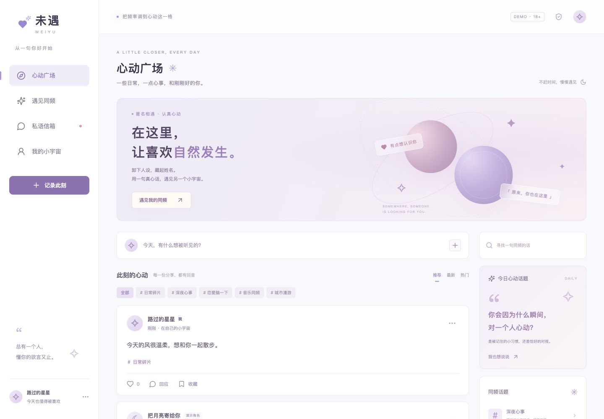

# 未遇 · WEIYU

**先对话，再心动，慢慢认识你。**

匿名恋爱社交 Web 原型。Preact + Signals API + H3 v2 + Tailwind CSS，服务端 SSR + 浏览器 hydration，部署至 Cloudflare Workers，D1 保存按浏览器隔离的演示数据。

在线体验：[weiyu.bool.win](https://weiyu.bool.win)

## 界面预览

移动端优先，截图中的角色、内容和聊天均为演示数据。

<p>
  
  
</p>



## 原型功能

- 心动广场：话题筛选、内容/昵称搜索、推荐/最新/热门视图、发动态、点赞、评论、收藏、举报演示与屏蔽。
- 遇见同频：展示七日匿名相遇流程，开启与固定演示角色「晚风」的相遇。
- 私语信箱：发送文字、规则生成的模拟回复、记录单向心动、申请交换资料与结束相遇。
- 我的小宇宙：编辑匿名昵称、简介和相遇意向，查看自己的动态/收藏，重置演示。
- 移动端优先的清爽浅色界面，雾白底与淡紫点缀，桌面侧栏与手机底部导航，直接访问四个页面均有完整 SSR 首屏。

## 演示范围

所有人物、动态、匹配和回复均为虚构。没有真实用户互聊、AI 实时回复、真实在线人数、实际匹配算法、七天任务计时或照片交换。七日相遇目前用于流程展示。相遇意向按钮用于交互展示，不影响固定演示匹配。默认「推荐」使用种子顺序，「最新」将个人新动态置顶，「热门」按演示点赞数排序。

发布和其他操作只影响当前浏览器的演示空间，不会展示给其他访客。每个空间最多发布 30 条动态，每条 30 条评论，对话最多 100 条消息。举报仅记录状态，没有接入审核人员。

演示数据以高熵 HttpOnly、SameSite=Strict Cookie 隔离，HTTPS 下带 Secure，每次访问/操作延长七天有效期；数据库每日清理过期空间。清除 Cookie 后无法恢复。此机制不是正式账号认证，也不提供端到端加密。请勿输入真实身份、联系方式或敏感信息。当前只通过 18+ 标识说明体验范围，没有真实年龄核验。

## 本地运行

使用 Node.js 22.12+。

```sh
npm ci
npm run db:local
npm run dev
```

打开 `http://localhost:5180`。`npm run dev` 先构建再运行 Wrangler；修改源码后重新构建/启动即可。`npm run preview` 只运行已有构建。

## 架构

```text
src/
  app.tsx            # 广场、匹配、聊天、个人页和弹窗
  data.ts            # 模拟数据、数据类型与操作规则
  store.ts           # 每次 SSR 请求独立创建 Signals store
  client.tsx         # 从 SSR bootstrap 恢复同一状态并 hydrate
  style.css          # Tailwind CSS v4 与视觉样式
  server/worker.tsx  # H3 v2 路由、SSR、Cookie 会话与 D1 存储
migrations/          # D1 演示库迁移
tests/               # 真实 H3 请求处理器的流程测试
```

Vite 分别构建浏览器资源和 Worker 服务端入口。SSR 使用构建清单注入 CSS/JS；预置数据进行安全 JSON 转义。状态不在服务端模块全局共享。API 写操作检查同源 Origin、JSON 类型、输入长度和操作上限。页面响应 `private, no-store` 并禁止搜索引擎索引。

## 检查

```sh
npm run build
npm test
npx wrangler deploy --dry-run
```

测试覆盖各路由 SSR、数据隔离与刷新持久化、动态互动、匹配/聊天/结束流程、资料修改、屏蔽/举报/重置、XSS 序列化与跨源/非法请求。

## 部署到自己的 Cloudflare

1. `npx wrangler login`。
2. `npx wrangler d1 create <你的数据库名称>`。
3. 在 `wrangler.jsonc` 修改 Worker 名称、D1 名称/ID、`routes` 域名。公开的数据库 UUID 不是访问凭证。
4. 修改 package.json 中迁移脚本的数据库名称，执行 `npm run db:remote`。
5. `npm run deploy`，构建与测试通过后发布 Worker。

Fork 后必须替换数据库与域名配置，不能直接操作此演示实例。仓库不含登录令牌、Cookie、运行时数据或 Cloudflare 密钥。GitHub Actions 在 push/PR 时构建测试；部署目前通过 Wrangler 执行，未配置推送自动发布。

本项目是可运行的产品原型。真实运营还需要账号/年龄核验、双方权限、并发消息协议、滥用控制和审核流程；当前演示库以整份状态保存，跨标签页同时写入存在覆盖可能。

## 开源许可

MIT © 2026 leoyanglab
