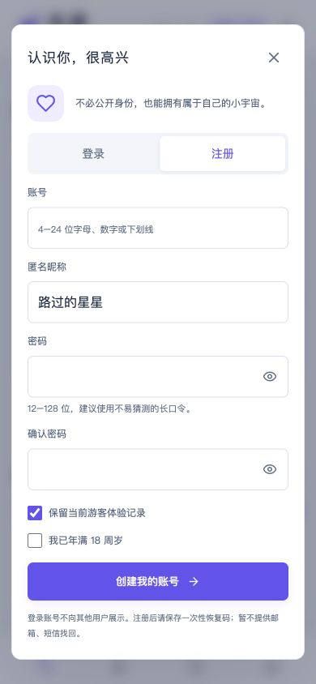

# 未遇 · WEIYU

**先对话，再心动，慢慢认识你。**

匿名恋爱社交 Web 原型。Preact + Signals API + H3 v2 + Tailwind CSS，服务端 SSR + 浏览器 hydration，部署至 Cloudflare Workers，D1 保存按浏览器隔离的演示数据。

在线体验：[weiyu.bool.win](https://weiyu.bool.win)

账号入口：[登录](https://weiyu.bool.win/login) · [注册](https://weiyu.bool.win/register) · [找回账号](https://weiyu.bool.win/recover)

## 界面预览

移动端优先，截图中的角色、内容和聊天均为演示数据。

<p>
  
  
</p>

<p>
  
  
</p>


## 原型功能

- 心动广场：话题筛选、内容/昵称搜索、推荐/最新/热门视图、发动态、点赞、评论、收藏、举报演示与屏蔽。
- 遇见同频：展示七日匿名相遇流程，开启与固定演示角色「晚风」的相遇。
- 私语信箱：发送文字、规则生成的模拟回复、记录单向心动、申请交换资料与结束相遇。
- 我的小宇宙：编辑匿名昵称、简介和相遇意向，查看自己的动态/收藏，重置演示。
- 真实账号：用户名密码注册、登录、退出、修改密码、恢复码找回和退出所有设备。账号状态存入 D1，支持跨设备登录。
- 注册可导入当前游客记录；登录已有账号不合并游客记录。不同账号的动态、收藏、匹配和模拟聊天相互隔离。
- 移动端优先的清爽浅色界面，清爽蓝紫主色、深色正文与中性灰辅助文字，桌面侧栏与手机底部导航，直接访问四个页面均有完整 SSR 首屏。

## 演示范围

预置人物、种子动态、匹配和回复均为虚构；账号注册和记录持久化是真实功能。没有真实用户互聊、AI 实时回复、真实在线人数、实际匹配算法、七天任务计时或照片交换。七日相遇目前用于流程展示。相遇意向按钮用于交互展示，不影响固定演示匹配。默认「推荐」使用种子顺序，「最新」将个人新动态置顶，「热门」按演示点赞数排序。

发布和其他操作只影响当前游客或账号的演示空间，不会展示给其他访客。每个空间最多发布 30 条动态，每条 30 条评论，对话最多 100 条消息。举报仅记录状态，没有接入审核人员。

游客数据以高熵 HttpOnly、SameSite=Strict Cookie 隔离，HTTPS 下带 Secure，每次访问/操作延长七天有效期；数据库每日清理过期游客空间。清除游客 Cookie 后无法恢复。注册可选择保留当前记录，账号记录无七天过期限制。

## 账号与会话

- 用户名为 4–24 位字母、数字或下划线，以字母开头，忽略大小写；它仅用于登录，不替代匿名昵称。
- 密码为 12–128 位，支持长口令；服务端使用 Web Crypto PBKDF2-SHA256、每账号随机盐、100,000 次迭代，仅存储派生结果。迭代数受 [Cloudflare Workers 的 PBKDF2 限制](https://github.com/cloudflare/workerd/issues/1346)约束。
- 登录使用随机 256 位令牌，数据库仅保存令牌摘要；Cookie 为 HttpOnly、SameSite=Strict，HTTPS 下带 Secure。默认有效期七天，登录时可选择 30 天；到期需要重新登录。
- 注册、改密、恢复找回时显示一次随机 128 位恢复码；数据库仅保存摘要。新恢复码生成后旧码立即失效。没有恢复码且忘记密码时无法找回，暂未接入邮箱或短信服务。
- 修改密码、恢复找回会撤销全部旧会话，再为当前设备签发新会话。退出所有设备需要验证当前密码；普通退出只撤销当前令牌。退出后使用全新的游客空间，账号记录保留。
- 登录与找回分别按账号和 IP 摘要限流，注册按 IP 摘要限流；写接口校验同源 Origin、JSON 类型与请求大小。账号/密码/恢复码不会写入日志或浏览器本地存储。
- 同一浏览器标签页通过 BroadcastChannel 和重新聚焦检查同步登录状态。注册需勾选已满 18 周岁，这是自我声明，不是真实年龄核验。

本项目不提供端到端加密、邮箱验证或人工找回。请勿提交真实身份、联系方式或敏感信息。

| 接口                        | 功能                                     |
| --------------------------- | ---------------------------------------- |
| `POST /api/auth/register`   | 注册、可选导入游客数据、返回一次性恢复码 |
| `POST /api/auth/login`      | 登录与可选 30 天会话                     |
| `GET /api/auth/me`          | 当前账号公开字段或 null                  |
| `POST /api/auth/logout`     | 退出当前会话                             |
| `POST /api/auth/logout-all` | 验证密码并退出所有设备                   |
| `POST /api/auth/password`   | 验证旧密码、修改密码并更换恢复码         |
| `POST /api/auth/recover`    | 恢复码找回、设置新密码并更换恢复码       |

## 本地运行

使用 Node.js 22.12+。

```sh
npm ci
npm run db:local
npm run dev
```

打开 `http://localhost:5180`。`npm run dev` 先构建再运行 Wrangler；修改源码后重新构建/启动即可。`npm run preview` 只运行已有构建。

## 架构

```text
src/
  app.tsx            # 广场、匹配、聊天、个人页和弹窗
  data.ts            # 模拟数据、数据类型与操作规则
  store.ts           # 每次 SSR 请求独立创建 Signals store
  client.tsx         # 从 SSR bootstrap 恢复同一状态并 hydrate
  auth-ui.tsx        # 登录、注册、恢复、改密、账号管理
  auth.css           # 手机端账号表单
  palette.css        # 全站统一的颜色变量与组件配色
  style.css          # Tailwind CSS v4 与视觉样式
  server/worker.tsx  # H3 v2 路由、SSR、Cookie 会话与 D1 存储
  server/auth.ts     # 密码派生、账号/会话持久化、限流
  server/auth-routes.ts # 同源账号接口与恢复码生命周期
migrations/          # D1 演示库迁移
tests/               # 真实 H3 请求处理器的流程测试
```

Vite 分别构建浏览器资源和 Worker 服务端入口。SSR 使用构建清单注入 CSS/JS；预置数据进行安全 JSON 转义。状态不在服务端模块全局共享。API 写操作检查同源 Origin、JSON 类型、输入长度和操作上限。页面响应 `private, no-store` 并禁止搜索引擎索引。

## 检查

```sh
npm run build
npm test
npx wrangler deploy --dry-run
```

测试覆盖各路由 SSR、数据隔离与刷新持久化、动态互动、匹配/聊天/结束流程、资料修改、屏蔽/举报/重置、XSS 序列化、跨源/非法请求，以及实际 SQLite 表结构下的注册、重复账号、跨设备登录、数据隔离、令牌撤销、恢复码单次使用、改密和限流。账号测试不依赖线上数据库。

## 部署到自己的 Cloudflare

1. `npx wrangler login`。
2. `npx wrangler d1 create <你的数据库名称>`。
3. 在 `wrangler.jsonc` 修改 Worker 名称、D1 名称/ID、`routes` 域名。公开的数据库 UUID 不是访问凭证。
4. 修改 package.json 中迁移脚本的数据库名称，执行 `npm run db:remote`。
5. `npm run deploy`，构建与测试通过后发布 Worker。

Fork 后必须替换数据库与域名配置，不能直接操作此演示实例。仓库不含登录令牌、Cookie、运行时数据或 Cloudflare 密钥。

## Git 推送自动部署

Cloudflare Worker `weiyu` 已通过原生 Git 集成连接 `leoyanglab/weiyu`，生产分支为 `main`。推送 `main` 后自动构建、测试并发布到 [weiyu.bool.win](https://weiyu.bool.win)。

- 构建命令：`npm run build && npm test`，失败时不执行部署。
- 部署命令：`npx wrangler deploy`。
- 构建环境：`NODE_VERSION=22`，项目根目录 `/`。
- 非生产分支预览构建已关闭。
- GitHub Actions 继续在 push/PR 时独立校验。部署由 Cloudflare 执行，使用其已有构建令牌，无需向 GitHub 保存 Cloudflare 密钥。

数据库迁移不随 push 自动执行。新增迁移应先审查并执行 `npm run db:remote`，再推送依赖该结构的代码。构建设置在 Cloudflare Worker「设置 → 构建」中管理。

升级已有实例时，先运行 `npm run db:remote` 应用 `0002_accounts.sql`，再部署新 Worker。迁移只增加账号相关表，不修改现有游客数据。定时任务清理过期游客空间、登录会话和限流记录，不清理账号记录。

本项目是可运行的产品原型。真实运营还需要真实年龄核验、双方权限、并发消息协议及审核流程；当前演示库以整份状态保存，跨标签页同时写入存在覆盖可能。

## 开源许可

MIT © 2026 leoyanglab

## 代码阅读与维护

[代码结构与阅读顺序](docs/architecture.md) 说明入口、模块职责和状态边界。统一格式：`npm run format`；检查格式：`npm run format:check`。
